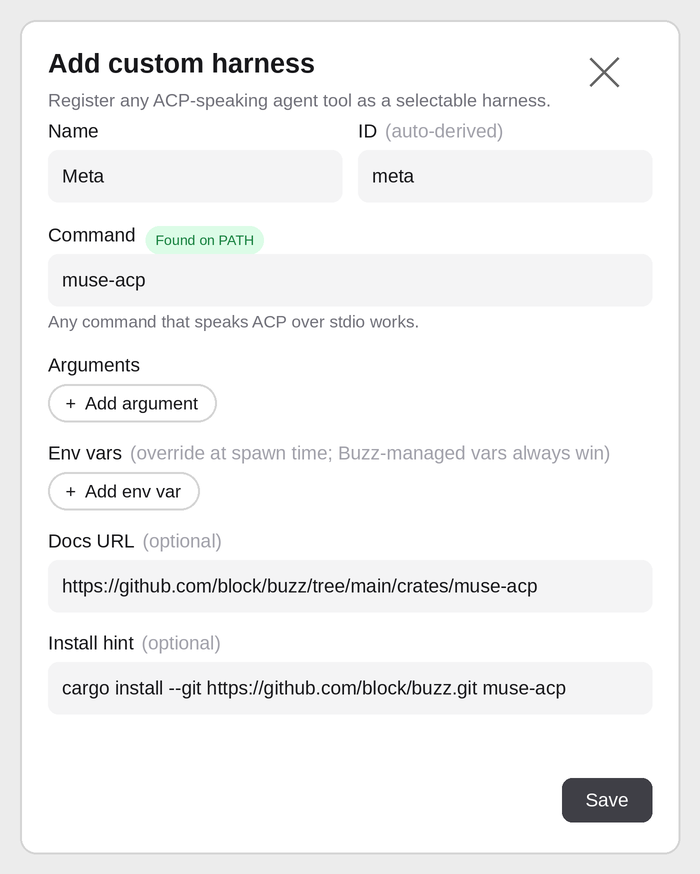

# muse-acp: Muse as a Buzz agent harness

`muse-acp` lets a Buzz channel talk to Muse — the Meta AI assistant behind
muse.ai — the same way it talks to Goose, Codex, or Claude Code: as a
first-class agent member of the channel.

There is no public Muse agent API, so the bridge does what the browser
does. It speaks the Agent Client Protocol (ACP) over stdio to `buzz-acp`
and relays each turn to the user's own Muse web session in Chromium, then
streams Muse's reply back into the channel as ACP message chunks. One Buzz
channel session maps to one browser tab, so each channel keeps its own
continuous Muse conversation — exactly the continuity you get chatting on
muse.ai, plus the channel's framed prompt as additional context.

## Use it today: Add custom harness (no PR needed)

You don't have to wait for the builtin catalog entry below. Buzz already
lets you register any ACP-speaking command as a harness:

1. Install the bridge in a terminal (see below for the pre-merge
   variant):

   ```sh
   cargo install --git https://github.com/block/buzz.git muse-acp
   ```

2. In Buzz, open **Add custom harness** (from New agent, or Settings →
   Harness catalog) and fill in the form like this:

   

   | Field | Value |
   |---|---|
   | Name | `Meta` |
   | ID | `meta` (auto-derived from the name) |
   | Command | `muse-acp` |
   | Arguments | none |
   | Env vars | none |
   | Docs URL | `https://github.com/block/buzz/tree/main/crates/muse-acp` |
   | Install hint | `cargo install --git https://github.com/block/buzz.git muse-acp` |

3. Hit **Save**. The Command badge reads **Found on PATH** once the
   binary is installed, and Meta becomes a selectable harness.

Two things worth knowing about this form: the Install hint is guidance
text shown in the catalog when the binary isn't detected — it is not an
auto-installer, so run the command in a terminal first. And custom
harnesses resolve their command from `PATH` with no auth probe, so
sign-in state is handled by the bridge itself (see below), not by Buzz.

Until this PR merges, the `--git` command above installs from `main`,
which doesn't have this crate yet — check out this branch instead and
run `cargo install --path crates/muse-acp` from the repo root.

## Install (after this PR merges)

From the Buzz desktop app, pick **Meta** in the agent harness dropdown and
hit **Install**. That runs:

```sh
cargo install --git https://github.com/block/buzz.git muse-acp
```

which builds this crate from source (a Rust toolchain is required) and
places `muse-acp` on `PATH`. There are no prebuilt binaries yet; the
install script story can graduate to that once releases exist.

Manual equivalent:

```sh
cargo install --path crates/muse-acp
```

## First run: sign in once

The bridge launches Chromium with a persistent profile at
`~/.muse-acp` (override with `MUSE_ACP_PROFILE`). On first run, with no
saved session, it opens a **visible** browser window and waits for you to
sign in to Muse. Once the composer appears, the session is recorded and
later runs go headless. To force headed/headless:

```sh
MUSE_ACP_HEADLESS=0 muse-acp   # visible window (sign-in)
MUSE_ACP_HEADLESS=1 muse-acp   # headless (requires a saved session)
```

Check sign-in state without launching a browser (this is also the
desktop catalog's auth probe):

```sh
muse-acp auth status   # exit 0 = saved session, 1 = none
```

If the saved login expires, the next turn fails with a clear
`NotSignedIn` error and the following run waits for sign-in again — the
stale marker self-heals instead of stranding turns.

## How a turn flows

1. `buzz-acp` spawns `muse-acp` (no arguments) and sends ACP over stdio:
   `initialize` (protocol version 2), `session/new`, `session/prompt`,
   `session/cancel`.
2. On the first prompt of a session, the `systemPrompt` from `session/new`
   is prepended to the message. That prompt carries the channel context
   buzz-acp framed (channel identity, instructions, history pointers),
   forwarded verbatim — the bridge adds no paraphrase between the channel
   and Muse. Later turns send only the new message; the tab already holds
   the conversation.

## Side-chat routing: a tagged wake goes to that channel's side chat

A tagged wake should not land in yet another fresh Muse web chat. It
should land in the Muse side chat that already holds that channel's
conversation — the side chat a user would open by hand for that channel.

`muse-acp` derives the channel on every wake, from three sources in
order:

1. The prompt text's `Channel:` line (buzz-acp frames each wake with
   `Channel: MASKY-CMO (#<uuid>)`).
2. The `session/new` `_meta.sessionTitle` (`Agent · #channel`).
3. The `session/new` standing prompt's `Channel:` line, as a fallback.

It then, on the first turn for that channel in a tab, clicks the side
chat whose title matches, in order: an explicit
`MUSE_ACP_SIDE_CHAT_MAP` entry, `<channel> (buzz)`, then the bare
channel name. Matching is case-insensitive and by first text line, so a
list item that shows a title plus metadata still matches. Later turns
in the same channel skip the click — the tab is already there — and a
wake for a different channel re-routes the tab.

If no side chat matches, the default (`MUSE_ACP_SIDE_CHAT_MODE=auto`)
falls back to the tab's current conversation (fresh after the new-chat
step) and logs the chat-list titles it did see, so the mapping can be
fixed without the channel losing its reply. `strict` fails the turn
instead, and `off` disables routing entirely and restores the old
fresh-chat-only behaviour.

Caveat, stated plainly: the chat-list selectors are, like the rest of
`src/selectors.rs`, unverified against the live logged-in muse.ai app
until a signed-in run confirms them. The selection script is built to
fail diagnostically — on a miss it reports the candidate titles it saw
— rather than silently clicking the wrong chat. Until that run happens,
treat side-chat routing as implemented and mock-tested, not
live-verified (see "The DOM model" below).

### Mock simulation (no Meta login needed)

The routing can be exercised end to end without a Muse account, by
pointing the bridge at a local page that mimics the shape of muse.ai —
a sidebar of titled chat buttons, a composer, and an assistant message
element — and feeding it ACP by hand:

```sh
# Serve a mock page (sidebar buttons, composer, assistant element)
python3 -m http.server 8765 --directory /tmp/mock-muse

# Build the bridge, then run it against the mock page
cargo build -p muse-acp
MUSE_ACP_MUSE_URL=http://127.0.0.1:8765/ \
MUSE_ACP_CHROME=/opt/meta-chromium/chrome \
MUSE_ACP_HEADLESS=1 \
MUSE_ACP_PROFILE=/tmp/muse-acp-mock-profile \
  ./target/debug/muse-acp <<'EOF'
{"jsonrpc":"2.0","id":1,"method":"initialize","params":{}}
{"jsonrpc":"2.0","id":2,"method":"session/new","params":{"_meta":{"sessionTitle":"Muse · #MASKY-CMO"}}}
{"jsonrpc":"2.0","id":3,"method":"session/prompt","params":{"sessionId":"<id from step 2>","prompt":[{"type":"text","text":"Channel: MASKY-CMO (#3043c06d-6cf1-42f8-b1b0-cb2d61711ea1)\nMessage: hello from buzz"}]}}
EOF
```

A successful run streams a reply whose text names the selected side
chat (`Reply from MASKY-CMO (buzz) ...` on the mock page) — proof the
click happened before the submit, not just that a reply arrived.
`MUSE_ACP_MUSE_URL` is a test seam only; production always uses
https://muse.ai/.
3. The bridge submits the message in the tab (composer + send, or Enter),
   polls the reply, and emits each text delta as an ACP
   `session/update` `agent_message_chunk`. It tracks message identity so
   the previous reply is never re-emitted, the user's echoed prompt is
   never relayed as Muse's reply, and a re-render resets the baseline
   instead of duplicating text.
4. When the reply settles (no stop control, no text growth for three
   consecutive polls), the turn answers `stopReason: "end_turn"`.
   `session/cancel` stops the reply and answers `"cancelled"`.

## ACP surface

Implemented: `initialize`, `session/new`, `session/prompt`,
`session/cancel` (notification). Everything else answers `-32601`.
Advertised capabilities: protocol version 2, no `loadSession`, no image /
audio / embedded-context prompt capabilities.

Not forwarded (by design): `mcpServers` from `session/new` (Muse web has
its own tools), model/effort/provider settings (Muse web exposes no such
controls to this bridge). Turns are serialized per session; a second
concurrent prompt on one session is rejected as "session busy".

## Channel discovery and creation (idempotent mapping)

A channel that has never been seen before must not create a second
side chat on every wake. `src/mapping.rs` is the contract:

- Discovery order for a channel and the side-chat titles the browser
  actually shows: a persisted mapping title if it is shown, then a
  default title (`<channel> (buzz)`, then the bare channel name) if
  it is shown.
- If no title matches, the mapping records the deterministic default
  title and returns `Created`; the driver's new-chat step is the UI
  creation for that chat. The bridge cannot rename a Muse web chat
  through the DOM, so the created mapping is the *intended* title —
  if the web app auto-titles the new chat differently, rename it by
  hand or set `MUSE_ACP_SIDE_CHAT_MAP` to that title.
- The mapping file (`MUSE_ACP_SIDE_CHAT_MAP_FILE`, a JSON object
  `channel -> title`, written atomically via temp file + rename) is
  loaded on resolve and saved only when it changes, so resolving the
  same channel twice with the same candidates returns the same title
  and does not duplicate entries. A missing file is empty; a corrupt
  file falls back to empty with a warning instead of stranding a turn.

## Thread-id contract: channel vs thread in a channel

Messages are not always addressed to a channel as a whole; they can
be addressed to a thread *in* that channel. `src/threading.rs` is the
contract, and it is deliberately separate from the channel mapping:

- **Channel** = where: name + optional UUID (`Channel: MASKY-CMO
  (#<uuid>)`). A channel maps 1:1 to a side chat.
- **Thread** = which conversation within that channel: `thread_root`
  (full event ID of the thread's top-level event) and `reply_to`
  (full event ID of the message being answered). Accepted prompt lines:
  `Thread:`, `Thread root:`, `Thread id:`, `Reply to:`,
  `Reply-to:`, `Event:` (triggering event, used as reply target when
  no explicit reply line is present).
- **Thread is not a mapping key.** Two threads in the same channel
  route to the *same* side chat, with different thread context. The
  ACP layer stores the thread context per session and overwrites it
  on every turn from that turn's prompt text, exactly as it does for
  the channel — a session reused across threads correlates to *this*
  wake's thread, not the first one it ever saw.
- **Session-title thread hints are truncated.** A thread-scoped
  session title is `Agent · #channel · <8-char thread root>`. Those
  8 characters can confirm a full root by prefix match, but they can
  never substitute for it. A full root must come from the prompt.
- **Correlation rule.** A reply to event `E` in thread rooted at `R`
  is threaded to `E` (`--reply-to E`) with thread root `R`. A reply
  to a top-level event `E` is threaded to `E` with thread root `E`
  (it starts the thread). A message with no event ID has no thread
  correlation: its reply is channel top-level.

## Buzz DM listener (dedup, routing, correlation)

Buzz itself (buzz-acp) remains the relay listener: it discovers DMs,
admits them under its author gate, and wakes an ACP agent. A DM in
Buzz is a channel whose metadata says `name: DM`, `t: dm` — it carries
no useful channel name, so a DM wake's session title is the bare agent
title. `src/dm.rs` is the muse-acp side for events Buzz delivers:

- **Dedup across restart:** `ProcessedEvents` is a file-backed set
  (`MUSE_ACP_DM_STATE_FILE`, a JSON array of event IDs, written
  atomically). An already-processed event ID produces no second
  reply, even after a restart that replays the same DM.
- **Failure handling:** an event is marked only after its reply is
  produced. A turn that fails before completion leaves the event
  unmarked, so a restart retries it instead of dropping it.
- **Routing:** a DM routes to a deterministic side chat from the DM
  conversation, not a channel title: `DM: <sender> (buzz)` when a
  sender label is known, otherwise `DM <first-8-of-dm-channel-id>
  (buzz)`. Different DM conversations never share a side chat.
- **Correlation:** a reply carries `reply_to_event_id` (the original
  DM event) and `thread_root` (the DM thread root, or the event
  itself for a top-level DM), following the same thread rule as
  channel threads.

Limitation, stated plainly: muse-acp does not speak Nostr and does
not hold a relay key — its identity lives in Buzz Desktop's agent
config — so it cannot be the relay-level DM discoverer, and the
`DM channel:` / `Event:` prompt framing that `parse_dm_from_text`
accepts is what a future buzz-acp DM wake would need to emit. Buzz's
current DM framing (bare title, DM context section) does not yet
carry those lines, so live DM routing via that parser is gated on
that framing landing in buzz-acp. The dedup, routing, and correlation
logic itself is fully tested here, independent of that framing.

## Visible-to-headless handoff (session continuity, separate from routing)

`src/handoff.rs` is the gate between the visible sign-in run and
later headless runs, and it is kept separate from routing on purpose:

- **Same profile, or it is not a handoff.** A visible run in profile
  A followed by a headless run in profile B fails the gate instead
  of silently losing the login the visible run created.
- **Headless requires a saved session.** A headless gate without a
  saved session fails with `NotSignedIn` before any browser launch;
  a visible gate always passes, because it is the path that creates
  the session. The driver checks this gate in `ensure_session_inner`
  before launching Chromium.
- **No credentials are copied or exposed.** The gate reads only the
  profile directory and the marker file's existence/version
  (`session.json`: `version` + `logged_in_at_unix` only). The marker
  contains no cookie, token, password, or key — a test asserts that
  any credential-like field in a marker fails.
- **Routing cannot flip the handoff, and vice versa.** The gate takes
  only profile + mode + saved-session flag; routing takes only
  channel + candidate titles. A routing miss never changes the
  handoff, and a handoff failure never re-routes a channel.

## The DOM model: the part that needs a logged-in run

`src/selectors.rs` is the bridge's model of the Muse web app's DOM
(composer, send/stop controls, assistant messages). It was written from
the standard shape of a chat web app, **not** verified against the live
logged-in app, and it says so in its own header. It is built to fail
loudly: probes report which candidate selector matched, and a turn that
cannot find the composer or a response ends with a `WebDom` error naming
what was looked for.

To verify or fix it: run headed (`MUSE_ACP_HEADLESS=0`) against a
signed-in session, watch stderr for the selector diagnostics, and replace
the candidate lists with the real hooks the app uses. Nothing else in the
bridge depends on those strings.

## Configuration

| Variable | Purpose |
|---|---|
| `MUSE_ACP_PROFILE` | Bridge profile dir / Chromium `--user-data-dir` (default `~/.muse-acp`) |
| `MUSE_ACP_CHROME` | Chromium binary path (default: `PATH` + well-known locations) |
| `MUSE_ACP_HEADLESS` | `0`/`1` to force headed/headless (default: headed until a session is saved) |
| `MUSE_ACP_LOG` | Log filter, e.g. `debug` (default `info`); logs go to stderr, never stdout |
| `MUSE_ACP_SIDE_CHAT_MODE` | `auto` (default: side chat, fall back to fresh chat on a miss), `strict` (fail the turn on a miss), `off` (never select a side chat) |
| `MUSE_ACP_SIDE_CHAT_MAP` | Comma-separated `channel=title` overrides, e.g. `MASKY-CMO=My CMO chat` (default titles are `<channel> (buzz)`, then `<channel>`) |
| `MUSE_ACP_SIDE_CHAT_MAP_FILE` | JSON file for the persisted channel -> side-chat mapping (see channel discovery above); unset = in-memory only |
| `MUSE_ACP_DM_STATE_FILE` | JSON file for processed DM event IDs (see DM listener above); unset = in-memory only, restarts replay DMs |
| `MUSE_ACP_MUSE_URL` | Test seam only: override https://muse.ai/ with a mock page (see mock simulation above) |

## Limitations (v1)

- Desktop only; the mobile app has no harness catalog for this to plug into.
- CDP traffic is serialized through one connection mutex, so turns on
  different tabs share the protocol layer (see `src/chrome.rs`).
- The bridge reuses the user's interactive Muse session: turns consume
  whatever plan/rate limits that session has, and Muse's replies are
  whatever the web app returns — there is no separate API quota.
- DOM selectors are unverified (see above). Until a logged-in run
  confirms them, treat this harness as experimental.
