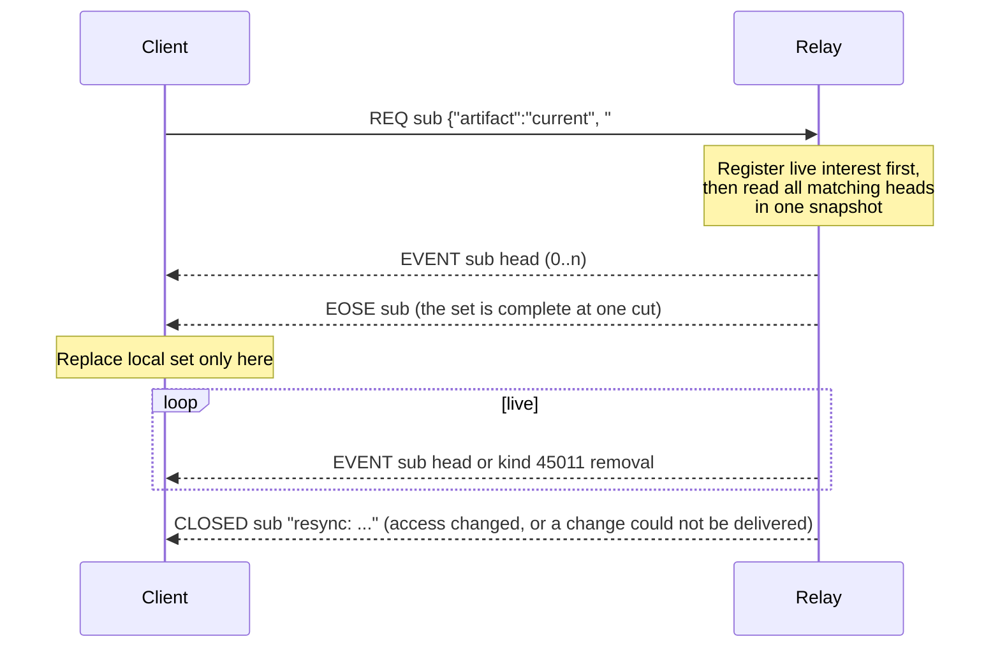

NIP-AR
======

Channel Artifacts
-----------------

`draft` `optional` `relay`

Defines `kind:45010` for editable records called **artifacts**. Each artifact has one home channel and may be attached to a thread. Its home determines who can read it. Any number of artifacts, including of the same type, may share a channel or thread.

The relay manages identity, access, and revisions. Clients define the content types, such as `buzz.task` or `buzz.project`.

## Event format

Each event contains a complete snapshot. For example, a task created directly in a channel (standard signing fields omitted):

```json
{
  "kind": 45010,
  "tags": [
    ["ar", "1"],
    ["d", "04737c81-e5e8-4412-bb47-f446813cfeba"],
    ["h", "9b353519-f4fe-4757-aef4-bec6cc0ae54c"],
    ["type", "buzz.task"],
    ["title", "Fix the payment timeout"],
    ["op", "create"],
    ["assignee", "<assignee-pubkey>"],
    ["project", "17cfe3ca-b3d0-4a76-a2a4-4eaf0d3a4109"]
  ],
  "content": "{\"version\":1,\"status\":\"open\"}"
}
```

The `assignee` and `project` tags and the payload are illustrative, not required fields; this NIP does not define a task schema.

| Tag | Meaning |
| --- | --- |
| `ar` | Envelope version; `1`. |
| `d` | Stable artifact UUID. |
| `h` | Home channel UUID. |
| `type` | Namespaced content type. |
| `title` | Absent on `delete`; otherwise required, nonblank display title, at most 512 UTF-8 bytes. |
| `op` | `create`, `update`, `move`, `delete`, or `restore`. |
| `root` | Optional conversation anchor event ID within `h`. |
| `prev` | Previous accepted revision ID; required except on creation. |

Each listed tag has exactly two string elements and occurs once, except optional tags may be absent and `title` MUST be absent on `delete`. UUIDs are lowercase, hyphenated, and non-nil; event IDs are 64 lowercase hex characters. Type names are dot-separated lowercase ASCII components, each starting with a letter and otherwise using letters, digits, `_`, or `-`, up to 128 bytes total. `buzz.*` is reserved for published Buzz client contracts.

Relays MUST reject invalid envelopes, unsupported envelope versions, and events with more than 256 tags. Normal event-size and write quotas apply.

Clients place fields needed for filtering in client-defined tags. The relay matches tag names and values without interpreting their meaning; `content` remains opaque text. Client-defined tags cannot override the envelope or grant access.

## Identity and edits

An artifact is identified by `(community, d)`, independently of its author or home. `d` and `type` are immutable. Kind 45010 is a regular stored event, not a NIP-01 addressable event. It falls in Buzz's forum and social kind range (45000–45999) but is not a forum post and follows none of the forum rules.

Creation requires an unused `d`, `op=create`, and no `prev`. Every later revision MUST name the current accepted event in `prev`. The relay checks authorization and advances the current revision atomically: two competing edits cannot both succeed. Timestamps do not choose the winner.

Resubmitting an already accepted event succeeds without applying it again, even if a later revision has since become current, so a client that lost an acknowledgement never sees a false conflict. The response reveals nothing the sender can no longer read. A different event whose `prev` is not the current revision is a conflict. On conflict, clients fetch the current revision and reconcile their changes rather than resubmitting with only `prev` replaced, which would overwrite the competing edit. An `update` keeps `h`; a `move` changes it.

A `create` whose `d` is already in use fails. When the sender cannot read the existing artifact, the error reveals only that the identity is taken, never its home, type, title, or current revision. Clients MAY derive `d` deterministically, for example from the message an artifact tracks, and accept that disclosure.

On creation or when changed from the previous accepted revision, `root` MUST identify an existing, undeleted conversation anchor in `h`. Later loss of that anchor does not prevent edits. Replies belong to that conversation, not to an artifact revision.

## Access

Channel read permission governs every artifact read, including lookups, history, search, previews, counts, and live updates. Threads inherit their channel's audience. Membership and visibility changes take effect on subsequent reads and deliveries.

Write permission means permission to post a kind-9 message in the channel, including authentication, token restrictions, moderation, and archive checks. Relays apply these checks the same way, and at the same point, as for a kind-9 message. This includes agents and, where channel policy permits, nonmembers of open channels. Artifact writes use `messages:write`, the scope that admits kind-9 posting.

| Operation | Required permission |
| --- | --- |
| Create, update, delete, or restore | Write in the home channel. |
| Move | Write in both source and destination. |

These rules apply to every type and do not depend on who created the artifact. DM participants are peers. The relay determines channel type from the stored channel, not from an artifact tag.

Relationship tags organize work without changing access. Linking a task to a project does not move it or share it. References to repositories or other services retain those services' access and action permissions. Errors MUST NOT disclose inaccessible artifact details.

## Moving and deleting

A move publishes the current snapshot into the destination under the same `d`. Its `root` must be absent or belong to the destination. Clients MUST show the destination audience and the information being shared before confirmation.

The relay MUST atomically advance the current revision and store both arrival in the destination and removal from the source. The source receives a separate relay-authenticated removal identifying the artifact, source scope, and the revision it replaced, without destination metadata or content. Both are stored events, so a client that misses live delivery recovers them by replaying the channel. Relays unable to provide this MUST reject moves.

Earlier revisions remain under their original channels' access rules; a move never lets the destination read revisions from the source. The destination can load current state without reading earlier revisions. Conversation messages stay where they are.

Deletion is a soft delete: a revision with `op=delete`, empty content, and no `title` tag. It preserves the current `type`, `h`, and `root`, and contains only envelope tags and NIP-OA `auth` tags the relay has verified. It removes the artifact from current-state queries and active views. Its revisions stay readable under their channels' access rules until redacted or expired by retention, so a lookup by `d` returns the deletion. After deletion, only `restore` is accepted: it names the deletion in `prev`, keeps its `h`, and carries a complete snapshot that becomes the current state again. A deleted `d` stays reserved and is never reused for another artifact. Completing or archiving work is a content change, not deletion or channel archival.

## Moderation and retention

Relays MUST reject kind-5 deletion requests targeting artifact revisions with an explicit reason. A NIP-29 kind-9005 removal redacts a revision under the channel's ordinary message-removal rules: the relay withholds that revision from every surface, including lookups, history, and search. The relay still records the revision as accepted, so redaction never changes which revision is current, and its ID remains valid as `prev`. Redacting an artifact's current revision retires the artifact: it is absent from current-state queries, and clients that do not already hold that revision's ID cannot edit it further. Revision history is subject to the community's retention policy; expiring earlier revisions MUST NOT remove the current revision or break `prev` checks.

## Current state and queries

An artifact's current state is its latest accepted revision, as determined by the `prev` rules above. Current-state queries MUST return only that revision and omit deleted artifacts. For example, a task whose current revision belongs to Project B no longer appears in Project A's list, even if an earlier revision belonged there. Revision history is queried separately. This NIP does not define a public acceptance order or history pagination. Relays record the order in which they accept revisions; clients observe the resulting current state through sync (see Sync), not through timestamps or `prev` chains.

Relays MUST support querying current artifacts across channels the reader can access using exact tag-name/value matches, including multi-character tag names. Conditions on different tag names are combined with AND; requested values for one name are combined with OR. A match compares the tag name and its first value in the same tag. Access checks and tag matching apply before pagination and any counts. Older revisions do not contribute matches.

Relays MUST advertise and enforce limits on tag-name/value sizes, total tag bytes, query predicates and values, and page size. Queries MUST run within an enforced execution budget. Unsupported or over-limit requests fail explicitly; predicates MUST NOT be silently ignored or incomplete results presented as complete.

Artifact revisions are state changes, not conversation messages. Receiving one MUST NOT increase chat or reply counts, add a chat unread, mark a conversation read, or repeat mention or push notifications for tags carried over from the previous revision.

## Sync

Sync lets a client hold an exact local copy of a set of artifacts and keep it current. The relay owns the order of changes: the relay already decides which revision is current (the `prev` check above), and sync only reports those decisions by always sending the current head. Clients do not order changes by `created_at`, which the signer chooses, or by walking `prev` chains, which needs every revision.

Sync is additive. A client that does not use it keeps working unchanged, and a relay advertises each part separately (see Relay information document). A reader receives through sync only artifacts that it can already read with a current-state query, under the same channel read permission.



### Sync subscription

**Request.** Sync is a NIP-01 `REQ` whose single filter has `"artifact": "current"`. It is the current-state filter of HTTP `/query`; the `REQ` transport adds the complete set, `EOSE` and live heads. The client does not page: the relay streams the whole set until `EOSE`. Other views (`history`, `head`) have no `REQ` form and stay HTTP-only:

```json
["REQ", "s1", {"artifact": "current", "#h": ["<channel>"], "#type": ["buzz.task"]}]
```

The filter MUST include `#h` with 1 or more channels. It accepts the same `#name` predicates and limits as a NIP-AR current-state query, with the same AND/OR rules, and also `kinds: [45010]`. It accepts no `limit` or `offset`. A relay rejects a filter without `#h`, or with an unknown key, with `CLOSED`.

**Scope.** The sync's scope is the set of artifacts that a NIP-AR current-state query with the same filter returns to this reader at that time. The rules below use this one definition for access, matching and system channels.

**Response.** The relay answers with ordinary NIP-01 messages. Only the meaning of `EOSE` is stronger: for a sync, it means "this is the complete set at one point in time", not only "end of stored events".

| Message | Meaning |
|---|---|
| `["EVENT", sub, <kind 45010 event>]` | This revision is the artifact's current head. If it is a deletion, or it no longer matches the filter, the client removes the artifact from its set. |
| `["EVENT", sub, <kind 45011 event>]` | Live only. A move removed the artifact from a channel the reader can read. The client removes it. |
| `["EOSE", sub]` | Sent once, after the initial set. The set has been delivered in full, as one consistent cut (rule 2). |
| `["CLOSED", sub, "resync: <reason>"]` | The relay can no longer keep this subscription exact. The client starts a new sync. |
| `["CLOSED", sub, "restricted: <reason>"]` | The reader cannot read a channel that `#h` names, or the channel does not exist. The message does not say which. |
| `["CLOSED", sub, "error: <reason>"]` | The sync failed. The client keeps its last complete set and treats it as possibly stale. |

Rules:

1. **Live before stored.** The relay MUST register live interest, and wait until it is active, before it opens the snapshot of rule 2. Live interest is active only when the pub/sub server has confirmed the subscription (for Redis, the reply to `SUBSCRIBE`) and the node's pub/sub connection is still up. While that connection is down or reconnecting, a new sync waits, or gets `CLOSED "error: ..."`. Then every change that commits after the snapshot causes a live entry, or a resync when the relay detects that the entry was lost (rule 5). This is the order that `REQ` already uses. The relay MUST NOT send a live entry before `EOSE`. During the read it holds the `d` of each changed artifact. After `EOSE` it reads and sends their heads as in rule 3. A held change can already be in the snapshot; then the relay sends the same head again, a newer one, or nothing (rule 4). The held list is bounded: if it grows past `max_events` distinct `d`, the relay sends `CLOSED "resync: ..."` and no `EOSE`.
2. **Initial set: one consistent cut, read in pages.** The relay reads the set inside one read-only transaction that has one database snapshot (Postgres `REPEATABLE READ`). It opens the transaction after it receives the `REQ` and after rule 1, on the writer database or on a replica proven at least as fresh. So every change that the relay accepted with `OK` before it received the `REQ` is in the set. Inside the transaction it reads pages ordered by `d`. Each page starts after the last `d` of the page before it (keyset pages, not offset pages). All pages see the same snapshot. So the set at `EOSE` is the exact set at one point in time: a combination of heads that existed together, never a mix of earlier and later states. This is the complete-set read. The relay sends one `EVENT` for each artifact in scope as it reads it, then `EOSE`. The client sees one stream; it never joins pages. A snapshot does not need the whole set in one result, so there is no byte limit on the whole set. The relay bounds how long it holds a snapshot open, with a budget that it defines. It MAY copy pages into a bounded buffer so that it can close the snapshot before a slow reader has received them. If the read fails, the snapshot is lost, or the budget runs out (for example, the reader is too slow), the relay sends `CLOSED "error: ..."` and no `EOSE` (rule 8). It MUST NOT continue the read on another snapshot. If the reader cannot read a channel that `#h` names, the relay sends `CLOSED "restricted: ..."` and no `EOSE`, whether or not the channel exists.
3. **Live changes.** After `EOSE`, when an artifact in scope changes, the relay reads its current head. If the reader can read the head's channel, it sends the head, even when the head is a deletion or no longer matches. If the artifact moved to a channel the reader cannot read, it sends the kind 45011 removal stored in the source. It never sends anything about an artifact the reader cannot read. A change is an accepted revision (any `op`), or a move's removal from the source. An artifact is in scope for a change when it was in scope before the change or is in scope after it. "Before" is the client's copy as this sync sent it: the initial set plus later heads that matched. "After" is a current head, not a deletion, that matches every predicate of the filter with the NIP-AR match rule (the tag name and its first value in the same tag). The relay sends nothing for an artifact that is in scope neither before nor after, so a head that never matched the filter never reaches the client.
4. **Heads only, never older.** The relay sends the current head, never an older revision. It MAY skip intermediate revisions and MAY repeat a head the reader already has. For any one `d`, it MUST NOT send a head that it read before the head it last sent for that `d`. To keep this, for each sync the relay reads the head of one `d` one read at a time, starts each read only after the result of the read before it (a head, a kind 45011 removal or nothing) is in the outbound queue, and reads from the writer database or a replica proven at least as fresh. Clients that need every revision use the NIP-AR history view.
5. **No silent loss.** Live fan-out can lose entries: a publish can fail, a node's pub/sub connection can drop for seconds, and a node's local fan-out can lag. Pub/sub does not replay any of these. A sync MUST NOT lose a change silently. So:
   - A node MUST send `CLOSED "resync: ..."` to every sync it serves that a loss on that node can affect: its pub/sub connection dropped or reconnected; its local fan-out lagged or dropped entries, including a message that it could not decode; or the connection's own send queue was full and dropped an entry for that sync. One drop is enough: the slow-client grace limit does not apply to a sync. It MAY resync every sync it serves.
   - If the node cannot queue the `CLOSED "resync: ..."` itself (for example, because the same send queue is full), it MUST close the connection. A client starts a new sync on any disconnect (rule 7), so a resync is never lost.
   - A node MUST retry a failed publish until it succeeds or the node stops. Delivery order does not matter. For a sync, a live entry is only a signal that one `d` changed. The reader's node never sends the published event itself to a sync; it reads the current head (rule 3). So a late retry of an older change sends the current head or nothing, never an older one (rule 4).

   So a sync that is open and has had no resync has received every change, except when a node crashes after it commits a change and before it publishes it. A client that must bound that window can sync again on its own schedule. The relay does not read the set again on a timer.
6. **Retirement.** A moderation redaction that retires the current revision of an artifact in scope makes the relay send `CLOSED "resync: ..."`. The relay withholds the redacted head, so a new sync is the only way the client learns that the artifact left the set. A relay MUST NOT retire a head in any other way that open syncs cannot observe, such as an operator delete outside NIP-29; it refuses such deletes or ends the affected syncs with `resync`.
7. **Commit point.** A client MUST replace its local set only when it receives `EOSE`. If the connection drops before `EOSE`, it discards what it received. After `EOSE`, it applies each live entry as it arrives. On any disconnect it starts a new sync; there is no resume. Before a new sync after a resync, an error or a dropped connection, the client waits a random delay that grows after each failure in a row (backoff with jitter).
8. **No partial success.** If the relay cannot deliver the full set within its limits or budget, it MUST send `CLOSED` and MUST NOT send `EOSE`. A closed connection without `EOSE` is never proof of an empty set. The relay bounds its buffers for a sync in bytes as well as in count, and it ends the snapshot and its reads as soon as the client disconnects or sends `CLOSE`.
9. **Resync.** The relay MUST send `CLOSED "resync: ..."` when the reader's access to a channel that `#h` names changes: membership, channel visibility or channel deletion. This closes the whole sync, also when `#h` names other channels. An ordinary `REQ` can keep its other channels; a sync cannot, because its set is no longer exact. Archive does not change reads (see Home channel lifecycle), so it does not cause a resync.

**Short-lived clients.** A CLI that needs the set one time sends the same `REQ`, waits for `EOSE`, then sends `CLOSE`. It gets the cut of rule 2: a complete set that includes every change the relay accepted before it received the `REQ`. It does not see changes after the cut. A writer catches those with `prev` (NIP-AR compare-and-set). There is no separate one-shot request.

**Set digest.** `set_digest` is the lowercase hex SHA-256 of the UTF-8 bytes `nip-ar-set-v1`, a zero byte, and then `<d>:<head event ID>\n` for each artifact in the set, sorted by `d`. It is a content identifier. It is not a counter, not a `prev` precondition and not a live-delivery cursor. An unchanged set has the same digest. A client can compute it over the set that it holds, or over any part of that set, and get the same value as any other client with the same heads.

The relay does not send the digest. A client computes it over the set that it holds at `EOSE` or later.

**Offset pages are views.** The existing `/query` offset pages stay for display and browsing. This section states that they are not evidence of a complete set.

### Head lookup, including deletions

Retries and "add or restore" flows need the current revision of one artifact even when it is deleted. Today a current-state query omits deleted artifacts, and history returns every revision.

Relays that support sync also support the query view `"artifact": "head"`. It requires `#d` and returns the current revision of each named artifact the reader can read, **including** a deletion. It returns nothing for an unknown `d`, or for one the reader cannot read; it does not say which.

### Deterministic identity and the ensure flow

Clients MAY derive `d`. This section defines one standard derivation, so that independent clients compute the same `d` for the same logical record:

```
d = UUIDv8( first 16 bytes of SHA-256("nip-ar-artifact\0" + h + "\0" + type + "\0" + key) )
```

`h` is the home channel at creation, `type` is the artifact type, and `key` is a client-chosen name, unique within that type and channel (for example a config entry name). Version and variant bits are set as in RFC 9562.

A derived `d` is a name, not a proof of authorship. Anyone who can write in `h` can create it first. Readers decide which authors to trust, as with every artifact.

**Ensure (create or restore, safe to retry).** To make "this record exists with this content" true, a client:

1. Sends `create`. If accepted or a duplicate of an accepted event, it is done.
2. On `conflict`, reads the head (see Head lookup).
   - If the head is a deletion, sends `restore` with `prev` set to it.
   - If the head is live with the same content and tags, it is done.
   - Otherwise sends `update` with `prev` set to the head, or reports the conflict, as the client's type requires.
3. Repeats step 2 on a further conflict, up to a client-defined limit.

The relay changes nothing for this flow except the head view. A deleted `d` stays reserved (see Identity and edits).

### Home channel lifecycle

| Home channel event | Writes | Current-state reads and sync |
|---|---|---|
| Archived | Rejected with the kind-9 archive reason. | Unchanged. Readers keep reading. To keep editing, unarchive or `move` the artifacts out first. |
| Unarchived | Allowed again. | Unchanged. |
| Deleted | Rejected. | Its artifacts leave every current-state result. Each live sync that covered the channel gets `resync`. A later channel with a different ID does not inherit them. |

### Client guidance (non-normative)

- **Type is the record family.** `type` cannot change. Put variants that can change (for example watch vs timer) in `content` under one type. If a family must change type, create new artifacts and delete the old ones.
- **Version the content.** Put `"version": n` in `content`. Ship readers that accept `n+1` before writers that produce it. Editors already keep unknown fields or decline the edit (see Client behavior).
- **Titles are visible to every reader of the channel.** Put no secrets in `title`.
- **Conflicts are normal.** On `conflict`, reload with the head view, reapply the user's change to the new head, and show the user when that is not possible. Do not resubmit with only `prev` replaced.

### Relay information document

The NIP-11 relay information document has an `artifacts` object. A relay that supports sync adds:

```json
"sync": {"version": 1, "max_events": 4096},
"modes": ["current", "history", "head"]
```

`max_events` is the largest set that a sync serves. It bounds each initial read and the held list (rule 1). There is no byte limit on the whole set: the relay reads and sends it in pages from one snapshot, and the relay's existing event size limit bounds each event. The relay does not advertise its snapshot time budget (rule 2); a reader that is too slow gets `CLOSED`.

and sets `websocket_query_extensions` to `true`.

Relays advertise `sync` and `head` only when every backend that can serve the connection runs them.

## Client behavior

Clients validate content before interpreting it as a known type. Unknown types or malformed content render a safe fallback using the title, type, and home link. Editors MUST preserve unfamiliar fields and annotation tags or decline the edit. References may be unavailable or cyclic; clients must handle them safely without assuming relay validation.

Artifact text is untrusted. A type name, relationship tag, or payload cannot authorize a privileged action. Moving, deleting, or revoking access cannot erase copies already downloaded.
